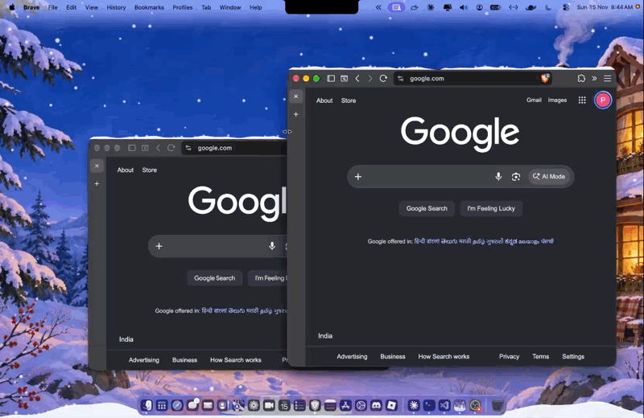
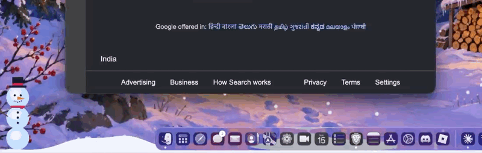
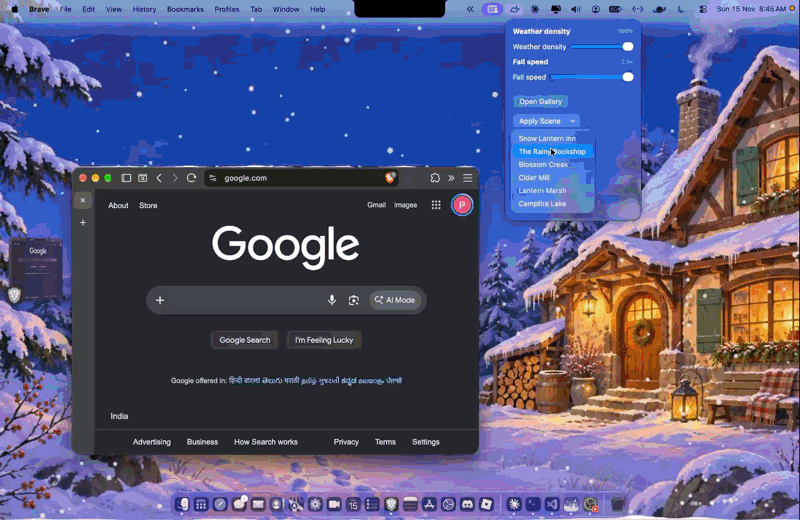

<div align="center">


# ❄️ Driftwood

**Snowfall and live weather for your Mac desktop**

A lightweight menu bar app that makes it snow, rain, or drift petals, leaves, fireflies and shooting stars over your wallpaper. The weather lands on your windows, piles up, and reacts when you move them.

[Features](#-features) • [Installation](#-installation) • [Demo](#-demo) • [Usage](#%EF%B8%8F-usage) • [Privacy](#-privacy) • [Architecture](#%EF%B8%8F-technical-architecture)

[](https://www.apple.com/macos/)
[](https://swift.org)
[](#-performance)


</div>

---

## ✨ Features

### Weather that knows about your windows
- **❄️ Snow that piles up** — Flakes land on window tops and the ground and build drifts that never form the same way twice
- **🪟 Real window physics** — Move a window and its snow rides along; shake it and the snow flies off both sides; resize it and only the unsupported strip falls, onto the window below
- **🖱️ Pointer interaction** — Brush snow off a ledge, scatter leaves, and gather fireflies by holding the pointer still
- **⛄ Snowmen and snowballs** — Roll a ball from the bottom of the screen, stack three for a snowman, or throw it
- **🚜 Snow plough** — Send a plough across the screen to clear the drifts
- **🌬️ Real physics** — Gravity, air drag and shared gusts of wind; big flakes fall faster, leaves rock as they fall

### Six scenes

| Scene | Weather | What it does |
|-------|---------|--------------|
| **Snow Lantern Inn** | ❄️ Snow | Piles up on windows and the ground |
| **The Rainy Bookshop** | 🌧️ Rain | Splashes on window tops, with lightning now and then |
| **Blossom Creek** | 🌸 Petals | Drift down and rest on your windows |
| **Cider Mill** | 🍂 Leaves | Pile up and scatter when the pointer brushes past |
| **Lantern Marsh** | ✨ Fireflies | Wander, and gather round a still pointer |
| **Campfire Lake** | 🌠 Meteors | Streak across and burst into sparks on your windows |

### And more
- **🖼️ Your own wallpaper** — Put any picture behind a scene's weather
- **🖥️ Multi-monitor** — Runs on every connected display
- **🔋 Battery aware** — Halves the weather on battery or in Low Power Mode
- **🔒 Private** — Works offline, asks for no permissions, collects nothing

---

## 📦 Installation

### Paste this into your AI coding assistant

Driftwood is installed from source. Use an AI assistant that can run commands on your Mac, such as Codex or Claude Code, and paste this prompt:

```text
Install or update Driftwood on my Mac from the latest main branch of
https://github.com/Parth-Dande/Driftwood-snowfall-for-mac.
Please run the commands and complete the installation, rather than just
showing me instructions.

1. Check that this Mac runs macOS 14 or later and has Xcode or the Xcode
   Command Line Tools. If the tools are missing, run xcode-select --install
   and wait for me to finish Apple's installer before continuing.
2. Clone the repository into ~/Developer/Driftwood if it is not already
   there. If it exists, verify its origin is the repository above (the old
   Parth-Dande/driftwood URL is also valid), check for local changes, fetch
   origin, switch to main, and update with git pull --ff-only origin main.
   Preserve local work; stop and explain any conflict or diverged history.
3. Read the repository instructions and build script, then run ./build.sh
   from the repository root. Wait for the build to finish successfully.
4. Verify build/Driftwood.app with codesign --verify --deep --strict and
   confirm its executable contains both arm64 and x86_64 with lipo.
5. Quit any running Driftwood app before replacing it. Update the existing
   installed copy if its location is writable. For a new installation,
   create ~/Applications if needed and copy the built app there with ditto.
   Request permission if the installed location requires elevated access.
6. Open the exact installed app path and confirm Driftwood is running.
   Tell me the installed path and source commit. I can then choose a scene
   and select Apply to All Displays.

Build locally from the checked-out source. Keep macOS security protections
in place; do not disable Gatekeeper or remove quarantine attributes.
```

### Updating

Paste the same prompt again to fetch the latest `main` and rebuild your installed app. Each update builds the current source, including changes since your last installation. An already installed app updates only when you run the prompt again.

Driftwood needs macOS 14 or later and runs on Apple silicon and Intel. Building locally avoids distributing a downloaded app that has not been notarized by Apple. The app has no package dependencies. If you prefer Terminal, follow [Building from Source](#%EF%B8%8F-building-from-source).

GitHub Actions builds and verifies the universal app on every push and pull request. Compiled apps stay out of Git; installation and updates build directly from source.

---

## 🎬 Demo

<div align="center">

**Snow lands on your windows, rides along when you move them and falls when you resize them**



**Roll snowballs from the bottom edge and stack three for a snowman**


**Send the plough through to clear the drifts**



**Six scenes: snow, rain, petals, leaves, fireflies and meteors**



</div>

---

## ⚙️ Usage

Driftwood lives in the menu bar (the cloud-and-moon icon). Close the gallery and the weather keeps running.

### Controls

| Control | Where | What it does |
|---------|-------|--------------|
| **Apply to All Displays** | Gallery | Shows the selected scene on every display |
| **Weather density** | Gallery, menu bar | How much falls; snowflakes also grow at the high end |
| **Fall speed** | Gallery, menu bar | Runs weather time slower or faster; the default is natural speed |
| **Motion** | Gallery, menu bar | Stops the weather and keeps the picture |
| **Plough** | Menu bar | Clears settled snow and snowmen |
| **Change Wallpaper…** | Gallery | Uses your own picture for the selected scene |
| **Clear** | Gallery, menu bar | Brings back your regular desktop picture |

### Playing with the snow
- **Move** a window steadily and its snow comes along
- **Shake** a window and the snow flies off
- **Brush** along a window top or the ground with the pointer to sweep snow away
- **Roll** a snowball by dragging up from the bottom edge of the screen
- **Stack** three snowballs to build a snowman
- **Throw** a snowball by letting go while moving fast

### Your own wallpaper
A landscape JPEG, PNG or HEIC at least as large as your biggest display in pixels stays sharp; the gallery shows the exact size. **Use Original** brings the bundled artwork back.

### Good to know
- The weather sits just beneath the Dock and above your windows, and clicks pass straight through it
- A full-screen app or a sleeping display pauses the weather
- Switching Space clears everything, and it starts again from nothing after about three seconds
- Your scene and slider settings are remembered

---

## 🔒 Privacy

- **No permissions** — Driftwood never asks for Screen Recording or Accessibility
- **No network** — It makes no connections and works fully offline
- **Window positions only** — It reads where windows are, in memory, to know where snow can land; never their contents or titles
- **No data collection** — Nothing is logged, stored or sent

---

## 🏗️ Technical Architecture

### Technology Stack
- **Language**: Swift with SwiftUI and AppKit
- **Rendering**: Core Animation, played back by the macOS compositor
- **Physics**: Custom model of gravity, linear air drag and a shared wind field
- **Platform**: macOS 14.0+ (Sonoma and later), universal binary

### Key Components

```
Sources/
├── App/
│   ├── DriftwoodApp.swift        # App entry point: gallery window and menu bar item
│   └── Desktop.swift             # Shared state: active scene, sliders, wallpaper windows
├── Interface/
│   ├── Gallery.swift             # Scene gallery
│   ├── StatusMenu.swift          # Menu bar controls
│   ├── SceneArtwork.swift        # Scene picture view
│   └── WeatherPreview.swift      # Lightweight preview in the gallery
├── Scenes/
│   ├── Scene.swift               # The six scenes
│   └── Wallpapers.swift          # Bundled and custom pictures
├── Desktop/
│   ├── WallpaperWindow.swift     # Window behind the desktop icons
│   └── NSScreen+DisplayID.swift  # Display helpers
├── Weather/
│   ├── DesktopWeather.swift      # Overlay windows, window tracking, timing
│   ├── WeatherView.swift         # Particles, drifts, plough and snowmen as layers
│   ├── WeatherPhysics.swift      # Flight paths, collisions, snowbanks
│   ├── WeatherModels.swift       # Bodies, flights, surfaces, drifts
│   └── WeatherSprites.swift      # Particle and prop images, drawn in code
└── Snow/
    ├── Snowballs.swift           # Rolling, stacking and throwing
    └── SnowPickupView.swift      # Grab strip along the bottom edge
```

### ⚡ Performance

Most weather apps redraw every particle on every frame. Driftwood works out each particle's whole path once and hands it to the macOS compositor, which plays it back at the display's own refresh rate.

- **No render loop**: Driftwood wakes about five times a second to launch particles and look at your windows
- **Native refresh rate**: Motion is as smooth as the display allows, including 120 Hz
- **Smooth dragging**: A window being moved is tracked from the pointer on every frame
- **Low overhead**: About 0.5% of one CPU core and 30 MB of memory at default settings on an Apple M4 with two displays; 1 to 3% with both sliders at maximum
- **Idle when hidden**: Pauses under full-screen apps and on sleeping displays

---

## 🛠️ Building from Source

### Requirements
- macOS 14.0+
- Xcode Command Line Tools or Xcode

### Build Steps

```sh
# Clone repository
git clone https://github.com/Parth-Dande/Driftwood-snowfall-for-mac.git
cd Driftwood-snowfall-for-mac

# Build the universal app into build/
./build.sh
open build/Driftwood.app
```

The build has no package dependencies. With only the Command Line Tools installed, `build.sh` picks an SDK whose SwiftUI does not need Xcode's macro plugin; set `DRIFTWOOD_SDK` to choose one yourself.

To start a scene straight away, pass its name:

```sh
open build/Driftwood.app --args -applyScene snow   # rain, petals, leaves, fireflies, stars
```

---

## 🙏 Credits and License

KoiArt’s public wallpaper gallery and weather demo video inspired the themed wallpapers, all-displays action, and desktop weather interactions. Driftwood’s artwork, particles, interface, and name were made independently. The six bundled wallpapers were generated for Driftwood with ImageGen. See [Resources/Artwork/REFERENCES.md](Resources/Artwork/REFERENCES.md) for the visual references and prompts. The app includes no KoiArt artwork, videos, branding, or code.

Driftwood reuses the desktop window and display identification code from [WallFlow](https://github.com/ritulsingh/WallFlow/tree/b0946f519e9b8143e223ba3a9dceeca454f206a8), copyright 2026 ritulsingh, under the MIT license. The desktop window code was adapted for this app. See [LICENSE-WallFlow](LICENSE-WallFlow) for the full upstream notice. The original Driftwood portions are also available under MIT terms in [LICENSE](LICENSE).
